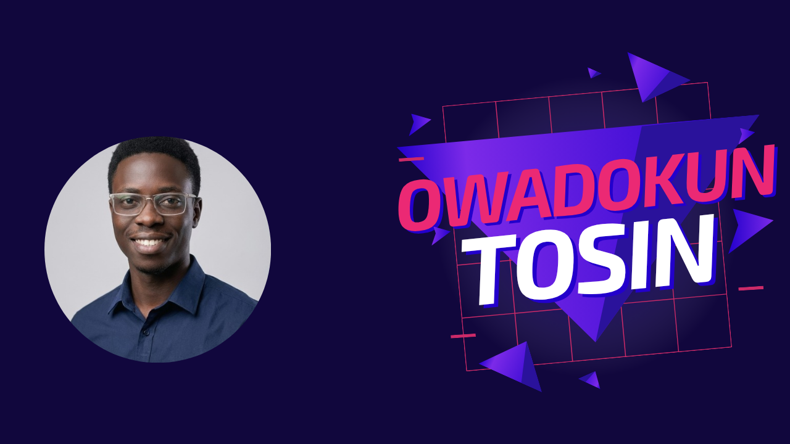

### Senior AI Engineer — autonomous agents, LLM evaluation, developer tooling

Lagos, Nigeria · Open to remote

I build agents that survive production: evidence-gated RAG, evaluation harnesses that gate every release, and tenant-isolated deployments where access control is real. Three years of shipping it — mostly Python and TypeScript on managed GCP.

**Right now**

- 🔧 **Shipping [dshify](https://github.com/Eatosin/dshify)** — an open-source CLI + DeepSeek Harness plugin that ports agent-harness setups (OpenCode first) to DSH with verification. ~1.8k weekly npm downloads, SLSA provenance, 171 tests.
- 🔒 **Contracting on privacy-preserving enterprise RAG** inside agency-managed GCP: multi-tenant isolation, clearance-level access control, and an eval suite shipped in the same release.
- 🎓 **Teaching** AI engineering at Torilo Academy — 10+ interns trained and certified on core SWE and applied ML.
- ✍️ **Writing** verified teardowns of agent security and hallucination failures.

## Featured work

| Project | What it does | Signal |
| :--- | :--- | :--- |
| **[dshify](https://github.com/Eatosin/dshify)** | CLI + DSH plugin for agent-harness migration, with verification | ~1.8k weekly npm downloads · 171 tests · SLSA provenance |
| **[Axiom Engine](https://github.com/Eatosin/lexpertz-axiom-engine)** | Autonomous auditing OS + MCP server — LangGraph, FastAPI, Next.js | 99%+ answer accuracy · sub-4s p95 |
| **[DocuTrace AI Auditor](https://github.com/Eatosin/DocuTrace-AI-Auditor)** | Verifiable document extraction on Google LangExtract + Gemini | source-grounded citations |
| **[Sentinel](https://github.com/Eatosin/Sentinel-MLOps)** | Anomaly detection + RAG root-cause agent | >2.5σ drift thresholds · live API |
| **[NewsAgent Pro](https://github.com/Eatosin/NewsAgent-Pro)** | Multi-agent research → write → critique pipeline | 60s prompt-to-post |
| **[Spectre](https://github.com/Eatosin/Spectre-Deepfake-Detection)** | Physics-informed deepfake audio detection | ResNet over Mel-spectrograms |

## Open source

**[google/langextract](https://github.com/google/langextract)** — shipped the `thinking_config` allowlist fix. Gemini 3 / thinking models were having the parameter silently filtered out, which forced the default high thinking budget and caused latency and timeouts ([issue #319](https://github.com/google/langextract/issues/319)). Landed upstream through [PR #553](https://github.com/google/langextract/pull/553), credited as co-author in the squash commit.

## Writing

- [Inside the TeamPCP LiteLLM Supply Chain Attack — and What to Do Right Now](https://medium.com/@tosinowadokun11/inside-the-teampcp-litellm-supply-chain-attack-and-what-to-do-right-now-b6162bb21dbb) · Medium
- [LLM Hallucination in Production: Why Your Staging Environment Will Never Catch It](https://tosinowadokun.substack.com/p/llm-hallucination-in-production-why) · Substack
- [AI Agent Security: The Complete Guide for Enterprise Builders in 2026](https://tosinowadokun.substack.com/p/ai-agent-security-the-complete-guide) · Substack
- [Claude Hallucinated a GitHub Repo ID and Deployed It to Production](https://tosinowadokun.substack.com/p/claude-hallucinated-a-github-repo) · Substack

## Toolbox

`LangGraph` · `LangSmith` · `MCP` · `RAGAS` · `OpenCode` · `Pydantic` · `Supabase` · `pgvector` · `CI/CD`
